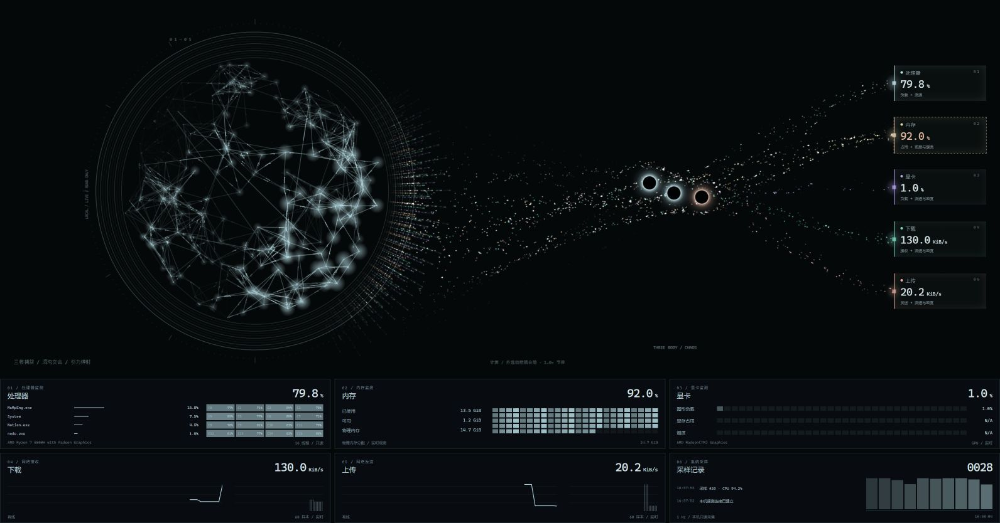
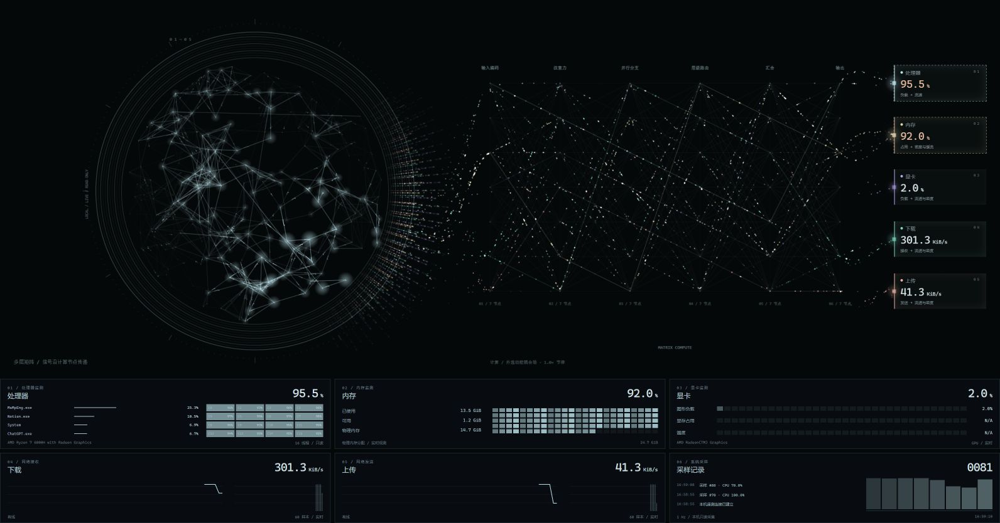
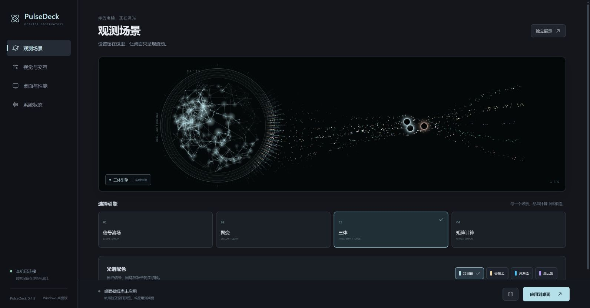

# PulseDeck

**让实时硬件数据，流动在你的 Windows 桌面上。**

PulseDeck 是一款 Windows 动态桌面壁纸与本机硬件观测工具。神经网络球体、精密计算圆环和粒子流随 CPU、内存、GPU 与网络负载变化；四种视觉引擎、四套配色和独立设置窗口，让桌面既能展示动态光效，也能查看实时状态。

[下载最新版本](https://github.com/Unorva/PulseDeck/releases/latest) · [版本记录](https://github.com/Unorva/PulseDeck/releases) · [反馈问题](https://github.com/Unorva/PulseDeck/issues)

## 运行预览

**三体引擎**：神经计算圆环、相互吸引的三颗黑洞、五组指标粒子，以及完整的硬件监测卡片。



<details>
<summary>查看矩阵计算与设置界面</summary>

**矩阵计算**：信号通过六层计算节点，再流向对应的指标卡片。



**设置界面**：独立管理场景、配色、视觉交互、桌面和性能选项。



</details>

以上为 v0.4.9 在本机浏览器预览中截取的真实运行画面，读数为截图时的本机状态。Windows 应用共用这些展示与设置页面，桌面嵌入和托盘功能通过 Windows 应用启用。

## 下载与开始使用

首个公开版本为 **v0.4.9**，适用于 **Windows 10 / 11 x64**。安装包包含运行时，无需安装 Node.js 或开启浏览器。

| 版本 | 下载 | 适合谁 |
| --- | --- | --- |
| 安装版 | [PulseDeck-Setup-0.4.9-x64.exe](https://github.com/Unorva/PulseDeck/releases/download/v0.4.9/PulseDeck-Setup-0.4.9-x64.exe) | 日常使用，可选择安装目录、创建桌面和开始菜单快捷方式 |
| 免安装版 | [PulseDeck-Portable-0.4.9-x64.exe](https://github.com/Unorva/PulseDeck/releases/download/v0.4.9/PulseDeck-Portable-0.4.9-x64.exe) | 直接运行，快速体验 |

1. 下载并运行其中一个版本，打开 **PulseDeck · 设置**。
2. 选择视觉引擎、配色和目标显示器，点击 **应用到桌面**。
3. 动画会出现在桌面图标后方；右侧五项硬件读数和底部六张监测卡片默认保留，可在设置中分别关闭。
4. 点击 **停止桌面壁纸** 恢复原有背景。关闭设置窗口后应用继续在托盘运行；通过托盘菜单或 **退出软件** 完全退出。

发布文件附有 [SHA256SUMS.txt](https://github.com/Unorva/PulseDeck/releases/download/v0.4.9/SHA256SUMS.txt)，可用 PowerShell 的 `Get-FileHash <文件路径> -Algorithm SHA256` 核对下载文件。

> 当前 Windows 安装包未进行代码签名，首次运行可能出现 SmartScreen 提示。请确认文件来自本仓库的 Release，并核对文件名和校验值后再决定是否运行。

## 四种视觉引擎

| 引擎 | 画面与交互 |
| --- | --- |
| 信号流场 | 连续粒子从圆环流向指标卡，随本机负载独立变化 |
| 聚变引擎 | 聚合与释放的艺术化流场，呈现恒星聚变般的节律 |
| 三体引擎 | 三颗黑洞在有限区域内相互吸引，牵引、偏转和捕获粒子；拖动其中一颗会影响另外两颗的轨迹 |
| 矩阵计算 | 输入编码、注意力、并行分支、层级路由、汇合、输出六层节点，信号沿连接逐层传递 |

所有模式共享左侧神经球体与计算圆环。精密径向数据条从环带内缘穿过整个环面，再过渡到外侧柔和扩散；出口沿圆环缓慢游移，两侧自然淡出。神经球体每五次有效新采样自动平滑转动并点亮局部节点。

五组粒子与 CPU、内存、GPU、下载、上传卡片使用一致颜色。各组有独立速度范围：CPU 影响流速，内存影响密度与缓流，GPU 和两路网络流量影响各自的速度与密度。粒子实际到达卡片时，会点亮对应接收点与边框。

## 外观与性能

- **四套配色**：冷白银、香槟金、深海蓝、星云紫，圆环、神经信号与黑洞光晕同步过渡。
- **可调光效**：流动速度、2,000–24,000 个粒子、光感、计算节拍、圆环宽度、粒子线宽和三体引力。
- **显示器选择**：壁纸运行在所选屏幕，适配屏幕实际像素与混合缩放；当前一次选择一块显示器。
- **性能控制**：24 / 30 / 60 / 90 / 120 FPS 上限，支持全屏应用时暂停、电池供电时暂停。动画暂停期间硬件采样继续。
- **渲染与交互**：WebGL 加速，无法使用时回退 Canvas 2D；靠近点亮节点、点击传播脉冲、拖动旋转球体。
- **独立控制**：设置、普通展示窗口与桌面壁纸分离；支持托盘操作，开机启动默认关闭。

浏览器仪表支持快捷键：`1–4` 切换模式、`Space` 暂停、`H` 沉浸、`F` 全屏、`Esc` 关闭弹窗或退出沉浸。浏览器仪表还提供详情图表和 PNG 截图预览、下载。

## 实时数据与隐私

读数来自本机操作系统、显卡驱动或性能计数器，不使用随机模拟数据。

| 数据 | 更新周期 | 口径 |
| --- | --- | --- |
| CPU | 约 1 秒 | 相邻操作系统计数器差值，总负载和每核负载 |
| 内存 | 约 1 秒 | 物理内存总量、已用量与可用量 |
| 网络 | 约 2 秒 | 有效物理网卡的下载 / 上传字节速率，排除重复、回环及常见虚拟、隧道接口 |
| GPU | 约 5 秒 | 优先使用驱动数据，Windows 可回退到 GPU 性能计数器 |
| 进程榜 | 约 10 秒 | CPU 占用前四名，仅包含进程名、PID 和 CPU 百分比 |

图表保留最近 60 个采样值。启动预热或硬件不支持时显示 `N/A`；连接中断时保留最后有效值并提示离线，随后自动重连。

Windows 应用通过内部本地协议读取遥测，不需要额外启动网页服务。浏览器开发及生产预览服务仅监听 `127.0.0.1`，遥测接口只读并限制同源访问。应用不提供云端遥测上传；桌面偏好保存在本机应用数据目录，浏览器预览偏好保存在当前浏览器中。

## 已知限制与常见问题

- **GPU 数据为 N/A**：温度、显存和利用率取决于硬件与驱动支持。多显卡优先选择最活跃的可用控制器；Windows 通用计数器回退值可能是所有适配器中最活跃引擎类型的总负载。
- **动画资源占用偏高**：降低粒子数量、帧率或光感，并启用全屏 / 电池暂停。实际帧率取决于屏幕分辨率、显卡和当前负载。
- **壁纸层未显示或桌面层已断开**：在设置中停止后重新应用壁纸。该功能依赖 Windows Explorer 桌面层；可用独立展示窗口检查画面是否正常。
- **三体模式的物理含义**：使用带软化项的牛顿引力与小步长积分，属于交互视觉模拟，不是相对论模型。其他模式采用艺术化流场。
- **平台范围**：本次只发布 Windows x64 安装包，未发布 macOS、Linux 或 ARM64 原生版本。

## 从源码运行

需要 **Node.js 22+、npm**；桌面壁纸功能需要 Windows 10 / 11。

```powershell
git clone https://github.com/Unorva/PulseDeck.git
cd PulseDeck/app
npm ci
npm run desktop:prepare
npm run desktop
```

根目录的 `Start-PulseDeck.cmd` 也可启动项目：优先使用本机 `release/` 中的 0.4.9 免安装版或已打包程序，否则尝试启动源码应用。克隆仓库不包含安装包，请从 Releases 下载，或自行构建。

浏览器开发预览：

```powershell
# 在 app 目录执行
npm run dev -- --port 4180
```

访问 `http://127.0.0.1:4180/` 查看仪表，`/?view=settings` 查看设置，`/?view=display` 查看桌面展示。桌面嵌入、托盘与开机启动仅在 Windows 应用中启用。

## 测试与构建

```powershell
# 在 app 目录执行
npm test
npm run build
npm run test:sites
npm run package:win
```

`package:win` 生成 x64 安装版与免安装版到根目录 `release/`，构建过程需要下载 Electron 及打包工具。只生成未封装的应用目录可运行 `npm run package:dir`。

生产网页预览先执行 `npm run build`，再执行 `npm start`，默认地址为 `http://127.0.0.1:4173/`，端口可通过 `PORT` 环境变量修改。

```text
app/electron/       Windows 窗口、托盘、壁纸嵌入与本地协议
app/src/            React 设置与仪表、Canvas / WebGL 视觉引擎
app/server/         本机硬件采样与浏览器预览服务
app/shared/         场景定义与偏好校验
app/tests/          数据采样、粒子路径、三体与构建测试
docs/releases/     版本说明
release/           本机构建产物（不纳入 Git）
```

## 版本与参考

[v0.4.9 发布说明](docs/releases/0.4.9.md) 记录首个公开版本的内容与验证范围；早期阶段说明保留在 `docs/releases/`，历史视觉检查记录见 [design-qa.md](design-qa.md)。

视觉灵感来自 aterrimus 的 [NEXUS 视频](https://www.douyin.com/video/7705833292104305954)。PulseDeck 根据公开视频独立实现，未使用原作者未公开的源代码，不代表原作者发布或背书。参考记录见 [docs/reference.md](docs/reference.md)。
